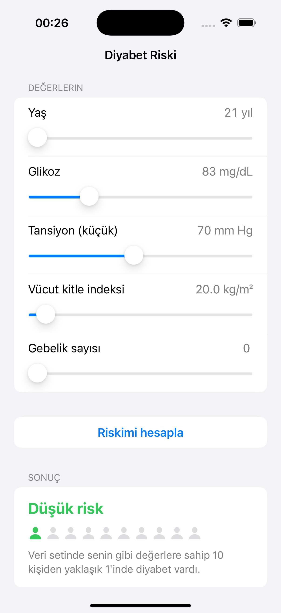
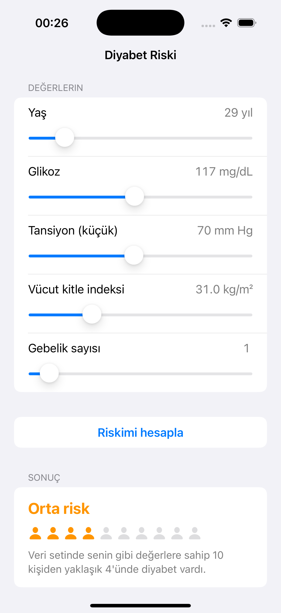
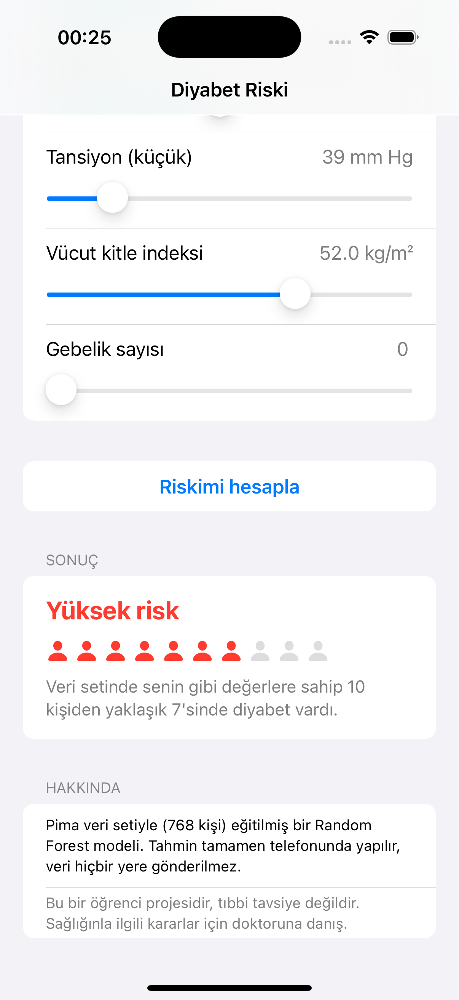

# Diabetes Risk — on-device ML for iOS

An iPhone app that estimates diabetes risk from five everyday health values.
The model is a Random Forest trained in Python, converted to **Core ML**, and runs **fully on the device**: no network, no data leaves the phone.

<p align="center">
  
  
  
</p>

> ⚠️ Student project for a data mining course. **Not medical advice.**

## How it works

```
diabetes_clean.csv ──► ml/model.ipynb ──► DiabetesRF.mlmodel ──► SwiftUI app
  (Pima, 768 rows)     clean, compare,      (coremltools)        sliders → risk level
                       calibrate, export
```

1. **Data** — Pima Indians Diabetes dataset (768 people, ~35% diabetic).
2. **Features** — only values a normal user can know: `pregnancies`, `glucose`, `diastolic`, `bmi`, `age`.
   `insulin` and `triceps` were dropped (about half missing, and users don't know them).
3. **Cleaning** — `0` in glucose / blood pressure / BMI means *missing*. These are filled with the median
   **computed on the training set only**, to avoid data leakage.
4. **Model selection** — 80/20 stratified split, 5-fold cross-validation on the training set.
5. **Export** — the final model is refit on all 768 rows and converted with `coremltools`.

## Results (held-out test set, 154 people)

| Model | Accuracy | Precision | Recall (diabetic) | Missed diabetics |
|---|---|---|---|---|
| KNN + StandardScaler (k=10, chosen by CV) | 0.740 | 0.67 | 0.52 | 26 / 54 |
| **Random Forest** (300 trees, `class_weight="balanced"`) | **0.747** | 0.62 | **0.74** | **14 / 54** |

For a screening tool, **missing a sick person is worse than a false alarm**, so recall was the main goal.
Balanced class weights cut the missed diabetics almost in half, for a small loss in precision.

## Honest risk levels instead of fake precision

The balanced Random Forest is **overconfident**: when it says "88%", the real rate is about 78%.
Showing "Risk: 62%" would also suggest a precision that 768 rows cannot support.

So the app shows **three levels**, and each one reports the *observed* diabetes rate in that group
(measured with cross-validation on the training set, then checked on the test set):

| Level | Model probability | Real rate (train, CV) | Real rate (test) | App message |
|---|---|---|---|---|
| 🟢 Low | < 0.30 | 12% | 11% | ~1 in 10 |
| 🟡 Medium | 0.30 – 0.60 | 36% | 43% | ~4 in 10 |
| 🔴 High | > 0.60 | 70% | 65% | ~7 in 10 |

## Known limitations

- **Small dataset** (768 people, one population: Pima women aged 21+). Results may not generalize.
- **Step-like decisions** — tree models split on thresholds. Around age 28 the predicted probability
  jumps (e.g. 27 → 0.27, 29 → 0.47 with the other values fixed), so a small change can switch levels.
- **Input ranges** — sliders are limited to the ranges seen in the data (e.g. age 21–81) so the model
  never predicts far outside what it has seen.

## Project structure

```
ml/
  model.ipynb            # full analysis: cleaning, KNN vs RF, threshold & calibration, Core ML export
  diabetes_clean.csv     # dataset
DiabetesRisk/
  project.yml            # XcodeGen spec
  DiabetesRisk/
    RiskPredictor.swift  # loads DiabetesRF, maps probability → Low / Medium / High
    ContentView.swift    # SwiftUI form, result card
    DiabetesRF.mlmodel   # exported Random Forest
screenshots/
```

## Run it

**iOS app** (Xcode 16, iOS 17+):

```bash
open DiabetesRisk/DiabetesRisk.xcodeproj
```

Then press **Cmd+R** with an iPhone simulator selected.

**Notebook** (retrain / re-export the model):

```bash
python3 -m venv .venv
.venv/bin/pip install "scikit-learn==1.5.1" coremltools pandas matplotlib seaborn ipykernel
.venv/bin/jupyter notebook ml/model.ipynb
```

`coremltools` currently supports scikit-learn up to 1.5.1, so that version is pinned.

## Tech

Python · pandas · scikit-learn · coremltools · Swift · SwiftUI · Core ML · XcodeGen

## License

MIT — see [LICENSE](LICENSE).
